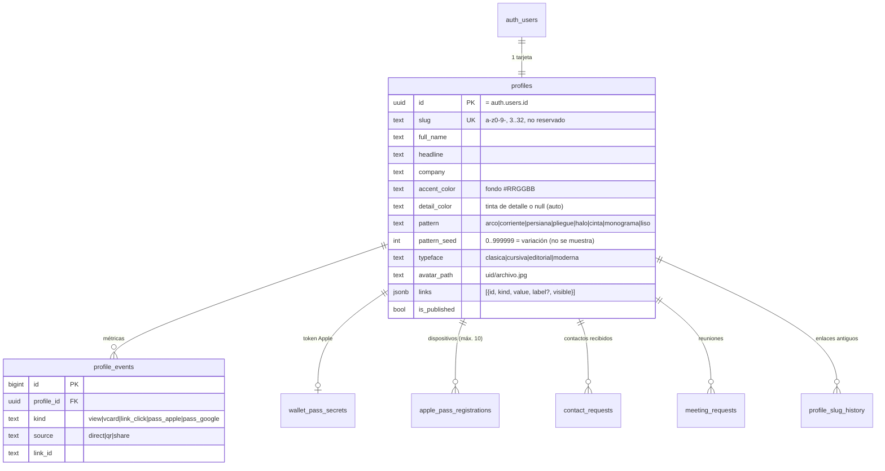
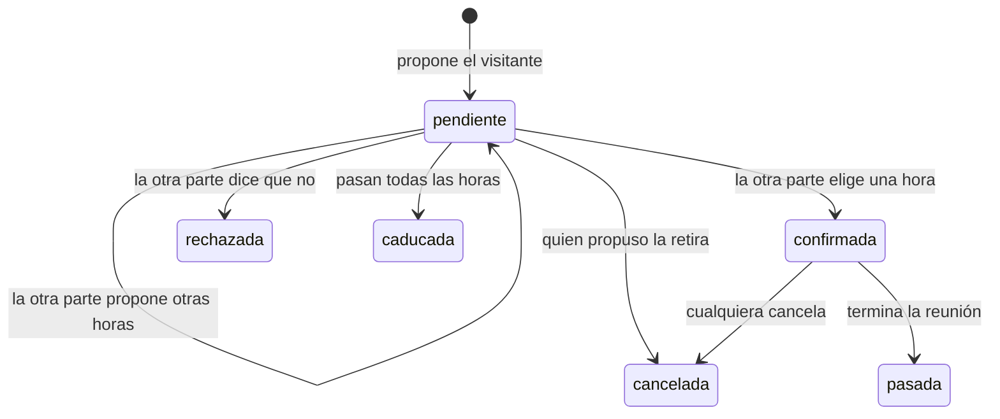
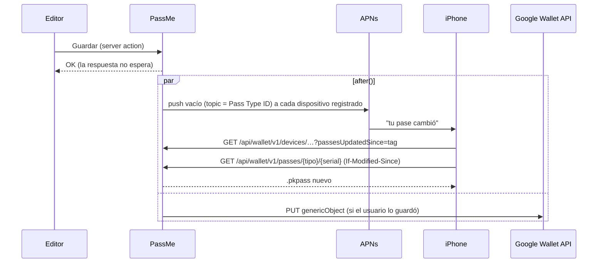
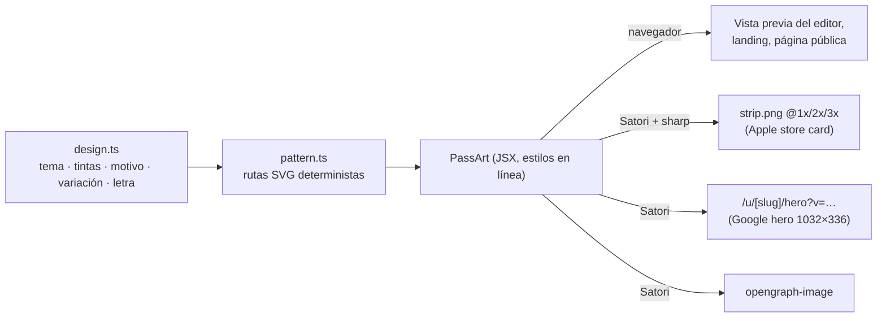

# Arquitectura de PassMe

## Flujo principal

```mermaid
sequenceDiagram
    actor Dueño
    actor Contacto as Otra persona
    participant Web as PassMe (Vercel)
    participant DB as Supabase
    participant Wallet as Apple / Google Wallet

    Dueño->>Web: Edita su tarjeta en /dashboard
    Web->>DB: saveCardAction (RLS: solo su fila)
    Dueño->>Web: "Añadir a Apple/Google Wallet"
    Web->>Wallet: .pkpass firmado / JWT "save to wallet"
    Note over Dueño,Wallet: Días después, en un evento…
    Dueño->>Contacto: Doble clic al botón lateral → QR
    Contacto->>Web: Escanea → /u/slug?src=qr
    Web->>DB: get_public_card(slug) — solo enlaces visibles
    Web-->>Contacto: Tarjeta + "Guardar contacto" (vCard)
    Contacto->>Web: "Agendar reunión" (opcional): 1–3 horas
    Web->>DB: submit_meeting_request
    Web-->>Dueño: Email con un botón por hora (enlace firmado)
    Dueño->>Web: /reunion/id/firma → confirma con un toque
    Web-->>Contacto: Invitación .ics + Google Calendar (y al dueño)
    Contacto->>Web: "Te dejo mi contacto" (opcional)
    Web->>DB: submit_contact_request → lo ve solo el dueño
    Contacto->>Web: "Crea la tuya" → /crear?de=slug
    Note over Contacto,Web: Rellena lo básico viendo su pase; al final email + código
    Web->>DB: verifyOtp + createCardFromDraft (misma petición)
    Web-->>Contacto: /dashboard?nueva=1 → su QR para enseñárselo al dueño
```

### Alta y acceso

- **La tarjeta primero, el email al final** (`/crear`): el borrador vive en el navegador (`localStorage`, 20 min) desde que se empieza a escribir: se guarda a los 300 ms de cada cambio y vuelve tal cual tras recargar. «Crear mi tarjeta» envía el código directamente al email de la tarjeta (o al de «Usar otro email»); si se pidió hace menos de 10 min, al recargar se vuelve a las 8 casillas. Con el código de 8 cifras, la tarjeta se crea en la misma petición que lo comprueba (`authAction` → `createQuickCard`). Si entra por el botón del email o con Google (quizá en otra pestaña), vuelve a `/crear` con sesión y la tarjeta se crea sola a partir del borrador guardado. Nunca se sobrescribe una tarjeta que ya tiene nombre.
- **El código es el camino principal** del email (iOS lo sugiere sobre el teclado; en Android se lee en la notificación) y el botón, la alternativa. La pestaña que espera el código detecta si el navegador ya inició sesión por el botón (al volver a ella o por `BroadcastChannel`) y continúa.
- **El botón del email no inicia sesión al abrirse**: `/auth/confirm` lleva a `/auth/entrar`, que pide un toque y verifica por POST. Los antivirus de correo (p. ej. Microsoft Defender) abren todos los enlaces, y el botón y el código comparten el mismo token: sin ese toque lo gastarían antes que la persona.
- La tarjeta creada sin intervención (al volver de Google o del botón) solo se crea si la sesión es de la misma cuenta a la que se envió el código; si no, el formulario espera un toque.
- Un usuario con sesión pero sin tarjeta que entra en `/dashboard` va a `/crear`. Los perfiles se crean ahí, de forma perezosa (ningún *trigger* de `auth.users` crea perfiles), así que un fallo en ellos nunca bloquea el alta.
- **Modo demo**: no se envía ningún email y el código es `00000000`, para poder probar el flujo completo (E2E incluidos).

## Módulos

| Capa | Dónde | Responsabilidad |
| --- | --- | --- |
| Dominio | `src/lib/card/*` | Tipos de enlace (validación + href seguro), esquema Zod, vCard 3.0, colores legibles, diseño (`design.ts`: temas, tintas, letra, variación) y motivos generativos (`pattern.ts`), slugs. Isomórfico: la misma validación en navegador y servidor. |
| Datos | `src/lib/data/*` | Lecturas/escrituras en Supabase. Cliente con sesión (RLS) para el dueño, cliente anónimo para lo público y cliente *admin* solo donde es imprescindible. `rate-limits.ts` (límites compartidos en Postgres), `contact-requests.ts` (contactos recibidos). |
| Pases | `src/lib/pass/*` | `apple.ts` (pass.json + firma), `google.ts` (objeto genérico + JWT + sync REST), `apns.ts` (push HTTP/2), `web-service.ts` (protocolo de Apple), `handoff.ts` (tokens de 30 min), `images.ts` (logo/icono con sharp), `art.tsx` (banda de Apple y *hero* de Google con Satori). |
| Rutas | `src/app/**` | Páginas (landing, tarjeta, alta `/crear`, login, editor, handoff, legales) y API (`/api/pass/*`, `/api/wallet/v1/*`, `/api/events`, `/api/health`, `/api/cron/cleanup`). Exportación de contactos en `/dashboard/contactos`. |
| CRM | `src/lib/admin/*`, `src/app/crm/*`, `src/components/admin/*` | Los datos del negocio para quien lo lleva: acceso propio (`auth.ts`, `session.ts`), cálculo puro por página (`stats.ts`, `users.ts`, `user-detail.ts`, `wallet.ts`, `activity.ts`, `leads.ts`), muestra para el modo demo (`demo.ts`); los datos los carga `src/lib/data/admin-stats.ts`. |
| Borde | `src/proxy.ts` | CSP con nonce por petición, refresco de sesión de Supabase, redirección de `/dashboard` sin sesión. |

## Modelo de datos



Además: `auth_otp_attempts` (HMAC de los emails que intentan un código, para bloquear fuerza bruta), `rate_limit_buckets` (contadores de límites por hash, tabla *unlogged*) y el bucket público `avatars`.

**Reuniones** (`meeting_requests`). Quien escanea propone 1–3 horas (`slots`, en UTC, más la zona horaria en la que las eligió). La fila guarda de quién es la propuesta vigente (`proposed_by`): responde siempre la otra parte (confirmar una hora, proponer otras o decir que no) y, una vez confirmada, cualquiera puede cancelar. Cada cambio sube `sequence`, que hace a la vez de versión (el `update` solo gana si nadie cambió la reunión entretanto) y de `SEQUENCE` de iCalendar. La lógica es pura (`src/lib/meetings/state.ts`) y está probada sin base de datos. Se borran 90 días después de la última hora propuesta.



**Enlaces antiguos.** Al cambiar el slug, un *trigger* guarda el anterior en `profile_slug_history`: redirige a la tarjeta actual (los QR impresos siguen valiendo) y nadie más puede reclamarlo. Si se borra la cuenta, sus enlaces quedan en cuarentena 90 días. Máximo 10 enlaces antiguos por tarjeta.

**¿Por qué los enlaces son JSONB?** Guardar la tarjeta es una única operación atómica, el orden va implícito y la lectura pública es una fila. La validación estricta vive en la app (`schema.ts`) y la base de datos pone límites de forma (array, ≤ 20, y cada enlace con `id`, `kind`, `value` y `visible` bien formados: `links_are_well_formed`, desde la migración del 17/10/2026).

## Modelo de seguridad

- **RLS en todas las tablas.** El dueño solo ve y edita su fila. Los visitantes anónimos no tocan tablas: llaman a `get_public_card()` (`SECURITY DEFINER`, `search_path=''`), que devuelve la tarjeta publicada **sin** los enlaces ocultos. Lo oculto nunca llega al navegador.
- **Tablas solo-servidor** (`wallet_pass_secrets`, `apple_pass_registrations`, `auth_otp_attempts`): RLS activado sin políticas; solo la clave secreta puede leerlas.
- **Enlaces seguros**: cada tipo normaliza la entrada y construye el `href` (solo `https:`, `mailto:`, `tel:`); `javascript:`/`data:` imposibles. Los `attributedValue` del pase de Apple se escapan.
- **Sesiones**: la app solo acepta sesiones de código, enlace del email u OAuth. `getSessionUser` y el proxy rechazan las que vienen de una contraseña o son anónimas (`session-claims.ts`), y un *trigger* en `auth.users` deja vacía cualquier contraseña, así nadie puede registrar el email de otra persona con su contraseña antes que ella. Cookies `Secure` en producción.
- **Avatares**: ruta validada en cliente, servidor y `CHECK` de Postgres; políticas de Storage limitadas a la carpeta del usuario (como mucho 20 archivos de 1 MiB); sin listado público. Al guardar, el servidor rechaza fotos de más de 1024 px o que no sean JPEG, PNG o WebP.
- **Pases**: se descargan con sesión o con un token HS256 de 30 min firmado con `PASSME_SIGNING_SECRET` (flujo "enviar a mi móvil"). El web service de Apple exige el token por pase (`ApplePass …`, comparación en tiempo constante) y tiene límites por IP y por pase; si la base de datos falla responde 503 para que Wallet reintente. Una tarjeta en pausa se entrega como pase mínimo (solo el estado, sin datos ni enlaces). Al borrar la cuenta, el pase de Google pasa a caducado. APNs solo borra un dispositivo cuando el token está muerto de verdad (410 o `BadDeviceToken`).
- **Login**: límites por IP (10 envíos de código cada 10 min; el botón del email, 20 cada 10 min y solo `type=email`), **bloqueo del código persistido** en dos capas: 5 intentos por email y dispositivo (IP) y 30 por email en total cada 15 min, así nadie puede bloquear a otra persona con cuatro códigos falsos (el intento se registra *antes* de comprobar el código, así que no hay carrera) y CAPTCHA opcional (Turnstile). Un fallo de Supabase (429, 5xx, red) no cuenta como código incorrecto: se devuelve el intento y se pide repetir. La API de verificación de Supabase también es pública: por eso el código es de 8 dígitos y caduca en 10 min (docs/SETUP.md). Redirecciones `next` limitadas a rutas relativas.
- **Límites de peticiones** compartidos por todas las instancias (`rate_limit_hit` en Postgres, claves con hash) con respaldo en memoria si la base de datos no responde (se registra como error, como mucho una vez por minuto). El login del panel privado falla cerrado. Las IPv6 se agrupan por /64 y las IPv4 mapeadas (`::ffff:…`) cuentan como su IPv4. Los eventos de métricas tienen además un tope de 5000 por hora y tarjeta.
- **Contactos recibidos**: formulario público con *honeypot*, límites por IP, por tarjeta y por visitante (los mismos datos, 2 veces por hora en la misma tarjeta; una sala entera con la misma Wi-Fi puede dejar sus contactos) y CAPTCHA opcional; los avisos por email al dueño tienen un tope de 10 al día por dueño y 20 al día en total (`CONTACT_EMAIL_DAILY_BUDGET`; comparten el plan de Resend con los códigos de acceso); se inserta con `submit_contact_request` (solo el servidor) y RLS limita la lectura y el borrado al dueño. Exportación CSV con fórmulas neutralizadas.
- **Reuniones**:
  - El formulario público tiene las mismas defensas que «Te dejo mi contacto» y se inserta con `submit_meeting_request` (solo el servidor). Cada tarjeta admite como mucho 30 propuestas vigentes sin responder, y 2 por email de visitante; las caducadas no cuentan y el dueño puede quitarlas. La limpieza de las 500 más antiguas nunca borra una propuesta pendiente ni una reunión confirmada por venir.
  - Cada parte entra con un enlace firmado `/reunion/<id>/<firma>`: un HMAC del id y del lado con `PASSME_SIGNING_SECRET`. No se guarda nada, el dashboard lo regenera y rotar el secreto los anula todos. El enlace no va dentro de las invitaciones de calendario (los calendarios se comparten).
  - Abrir el enlace no cambia nada; los cambios van por POST (los antivirus de correo abren los enlaces). La página no envía `Referer`.
  - Cualquiera puede crear una tarjeta y responderse a sí mismo, así que ningún lado es de fiar con la bandeja de otro:
    - Al email del visitante, que nadie ha verificado, solo llega texto fijo de PassMe con las horas, el formato y un lugar o enlace de vídeo validados. Las notas y el tema se quedan en la página firmada.
    - Los enlaces de vídeo solo valen de Meet, Zoom, Teams, Whereby, Jitsi o Webex.
    - Nombres, empresas, lugares y temas no admiten enlaces, dominios ni teléfonos, y se limpian de caracteres invisibles y de control de dirección.
    - El nombre de una tarjeta que parezca un enlace no llega a esa bandeja.
  - Límites de envío:
    - Como mucho 5 correos al día a una misma bandeja de visitante (la dirección se normaliza: mayúsculas, `+etiqueta` y puntos de Gmail cuentan como la misma) y 40 al día a visitantes por dueño.
    - Un tope diario global (`MEETING_EMAIL_DAILY_BUDGET`, 60 por defecto) para no agotar el plan de Resend, que comparten los códigos de acceso. El 40 % es lo más que pueden gastar los correos que provoca un anónimo (propuestas nuevas, retiradas y avisos de caducidad), y cada dueño recibe como mucho 30 primeras propuestas y 30 respuestas al día.
    - Los correos al visitante llevan `List-Unsubscribe`. Si un correo no sale, la página lo dice en vez de prometer que se ha enviado.
  - El primer email al dueño, el único que un anónimo puede provocar, solo lleva las horas, el formato, el nombre y la empresa. Las notas del visitante le llegan cuando ya ha respondido.
  - El email del dueño no se revela hasta que confirma: los correos al dueño antes de confirmar no llevan `Reply-To`, y la invitación `.ics` del visitante usa el email visible de la tarjeta, nunca el de acceso. Hay límites por reunión y por conexión, y como mucho 10 rondas de contrapropuestas.
  - El cron diario limpia primero y luego envía como mucho 100 avisos de caducidad (unos 40 s), cada uno con un reintento al día siguiente si falla.
- **CRM privado** (`/crm`; `/admin` redirige): usuario y contraseña propios en variables de entorno (sin ellas, 404), independientes de las cuentas de PassMe. Comparación en tiempo constante, contraseña de 16 caracteres o más, 5 intentos por IP cada 15 min y 1000 en total por hora (ambos fallan cerrados si la base de datos no responde), y una cookie de 3 días `httpOnly`, `SameSite=Strict` y limitada a `/crm`, firmada con una clave derivada de las credenciales (cambiar la contraseña la invalida). Cada página y la exportación CSV comprueban la sesión por su cuenta (`requireAdminSession`), y las páginas van sin `Referer`. Lee con la clave secreta: usuarios, tarjetas (de los enlaces ocultos, solo el tipo), pases de Apple (nunca los *push tokens*), eventos y quién trajo a quién; de los contactos recibidos y las reuniones de cada usuario, solo cifras. «Mis contactos» (`/crm/contactos`) enseña los contactos y reuniones completos solo de la cuenta de PassMe con sesión abierta en ese navegador, leídos con esa sesión (RLS), como el editor.
- **Datos del CRM** (migración 20261021120000): cada visita, clic y «Guardar contacto» guarda el tipo de dispositivo (`ios`, `android`, `other`, del *User-Agent*) y el país (dos letras, de `x-vercel-ip-country`), nunca la IP, con `record_card_event_v2()`; sin la migración se usa `record_card_event()` sin esos datos. Al crear una tarjeta, `profile_referrals` apunta desde qué tarjeta llegó (`?de=`) y cómo (QR, enlace), o que llegó por su cuenta; solo la leen el alta y el CRM con la clave secreta, y se borra con la cuenta (`referrer_id` pasa a `NULL` si se borra quien la trajo).
- **Enlaces de las tarjetas**: además de la lista de nombres reservados de siempre (un `CHECK`), los enlaces nuevos no pueden ser `soporte`, `ayuda`, `hola`, `equipo`, `seguridad`, `getpassme`, `oficial`, las rutas de la web ni empezar por `passme-`. Esa segunda lista solo se aplica al crear o cambiar el enlace (*trigger* y `checkNewSlug`): quien ya tenía uno lo conserva.
- **Salud**: `/api/health` solo dice `{ ok }` en público; el detalle de la configuración pide `Authorization: Bearer $CRON_SECRET`.
- **Cabeceras**: CSP con nonce + `strict-dynamic` (todas las páginas se renderizan por petición para poder llevar nonce), HSTS, `X-Frame-Options: DENY`, `Referrer-Policy`, `Permissions-Policy`.
- **Privacidad**: métricas sin IPs ni cookies (una visita por sesión del navegador); los clics solo cuentan si el enlace existe y es visible; los bots/previsualizadores no cuentan; las tarjetas llevan `noindex`. Retención: `cleanup_expired_data()` a diario (Vercel Cron).

## Actualización de pases



El número de serie del pase es el `id` del perfil; el `lastUpdated` es el `updated_at` en milisegundos.

## Arte del pase



Las imágenes se memorizan por versión del arte (colores, motivo, semilla, letra, nombre y foto). La guía visual completa está en [`BRAND.md`](BRAND.md).

## Decisiones

| Decisión | Motivo |
| --- | --- |
| Next.js en Vercel + Supabase | Lo pedido; cero servidores que mantener, plan gratuito suficiente para el MVP. |
| Perfiles creados en la app (ningún trigger en `auth.users` los crea) | Un fallo al generar el slug nunca puede bloquear un registro. El único trigger allí (`passme_blank_password`, 17/10/2026) solo vacía la contraseña y no puede fallar. |
| Pase *store card* de Apple | Es el único estilo con banda de imagen a todo el ancho (375×144 pt): ahí va el arte de la tarjeta (motivo, foto y nombre en la letra elegida). Los campos de texto reales (cargo, ubicación) siguen debajo para VoiceOver y el Apple Watch. |
| Un solo componente de arte (`components/card/pass-art.tsx`) | Estilos en línea y flexbox: el mismo árbol lo pinta el navegador (vista previa) y Satori en el servidor (PNG del pase). Lo que ves en el editor es lo que llega a la cartera. |
| Motivo con semilla guardada | La semilla (`pattern_seed`) genera el motivo de forma determinista; editar el nombre no cambia el dibujo, «Otra variación» sí. El número nunca se enseña: se elige a ojo. |
| Motivos retirados en lectura, no en validación | Los valores antiguos (`orbitas`, `relieve`, `trama`, `rayos`, y antes `sello`, `senal`, `ondas`) se traducen al leer (`toPatternKind`). El `CHECK` sigue aceptando los de la última tanda: las tarjetas los conservan hasta que su dueño vuelve a guardar, y la migración se puede ejecutar antes o después del despliegue. Los clientes nuevos solo pueden enviar motivos actuales. |
| QR sin `altText` en Apple | Wallet imprime ese texto bajo el código y agranda la placa blanca; el enlace ya está en el reverso del pase. |
| *Hero* de Google con `?v=` | Google cachea las imágenes por URL; la versión (hash de las entradas del arte) cambia solo cuando cambia el dibujo. |
| JWT con clase + objeto para Google | No hace falta llamar a la API para crear el pase; la API solo se usa para actualizar. |
| vCard 3.0 | La versión con mejor compatibilidad en iOS y Android. |
| Modo demo sin variables | Se puede enseñar y desarrollar sin credenciales; los tests E2E corren sin secretos. |
| Rate limit en Postgres | Sin otro proveedor que mantener: una llamada `rate_limit_hit` por petición limitada, compartida entre instancias. Si falla, cae a memoria. |
| Contactos recibidos opt-in | Privacidad por defecto: el dueño decide si su página muestra el formulario; el visitante da su consentimiento explícito. |
| Reuniones sin conectar calendarios | El que escanea propone horas concretas (los dos acaban de verse) y el dueño elige con un toque desde el email: sin OAuth ni verificación de Google, y sin la configuración que pide Calendly. La invitación va como `.ics` PUBLISH a los dos (una REQUEST enviada desde una dirección distinta a la del organizador se marca como sospechosa, y algunos calendarios la añadirían sin preguntar) más un enlace a Google Calendar. Conectar Google o Outlook queda para un plan Pro. |

## Ideas para después del MVP

- **Varias tarjetas por persona** (trabajo / personal) con contactos distintos.
- **Plan empresas**: una compañía da de alta a su equipo con su marca, colores y logo en el pase. Es el camino natural de monetización.
- **Modo evento**: fecha y lugar relevantes en el pase para que aparezca en la pantalla de bloqueo durante una feria.
- **NFC** en Apple Wallet (requiere solicitar el entitlement a Apple).
- **Sentry** (o similar) para errores en producción.
- **Inglés** y demás idiomas (los textos están centralizados por componente).
